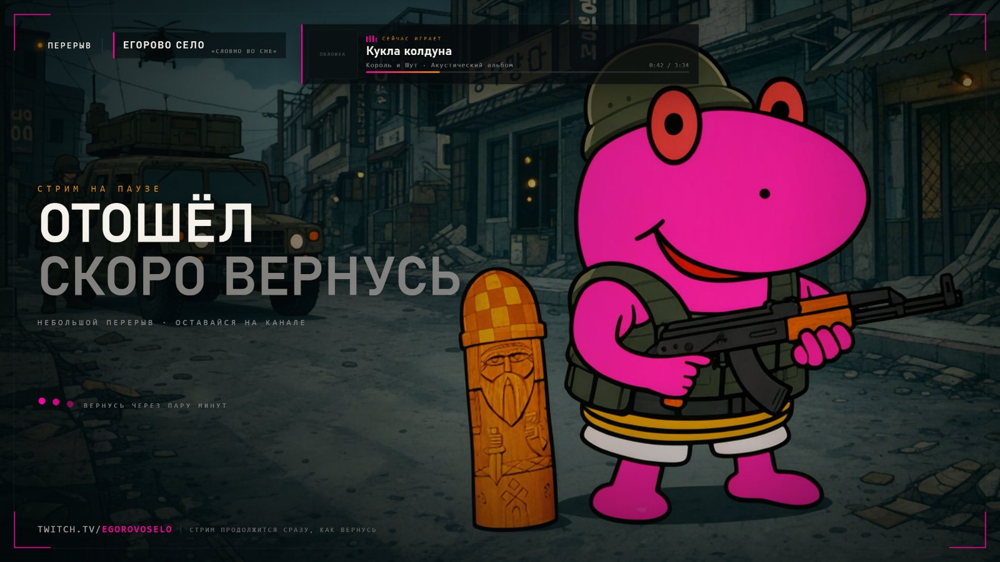

# Now Playing для OBS

Красивый виджет для стрима: показывает, **что сейчас играет** — обложку, трек, исполнителя,
альбом, эквалайзер, прогресс и время. Ставится за две минуты, настраивается мышкой,
работает локально (никакие данные никуда не отправляются).



<p align="center">
  <a href="https://github.com/Blazeeers/obs-nowplaying/releases">Скачать</a> ·
  <a href="#установка">Установка</a> ·
  <a href="#настройка-вида">Настройка</a> ·
  <a href="#если-музыка-играет-в-браузере">Вежливый браузер</a>
</p>

---

## Что умеет

- 🎵 **Обложка, название, исполнитель, альбом** — из плеера, без ручного ввода
- ▶ **Прогресс и время** трека, эквалайзер (замирает на паузе)
- 👻 **Сам скрывается**, когда музыка выключена — на стриме не висит пустая плашка
- 🎨 **Кастомизация**: цвета, стиль, позиция, ширина, какие элементы показывать
- 🧩 **Конфигуратор** с живым предпросмотром и готовой ссылкой для OBS
- 🔒 **Только локально**: `127.0.0.1`, без аккаунтов, токенов и внешних сервисов

Работает с приложением **Яндекс Музыки** (Windows), а также с любым плеером,
который отдаёт данные в Windows Media Session (Spotify, AIMP, VLC, «Музыка» и т. п.).

---

## Требования

| Что | Версия |
|---|---|
| Windows | 10 / 11 |
| Python | 3.9+ ([python.org](https://www.python.org/downloads/), галочка «Add to PATH») |
| OBS Studio | 28+ (нужен источник «Браузер») |

> Linux/macOS: сервер запустится, источником будет браузер через CDP (см. ниже),
> но нативный способ (SMTC) есть только в Windows.

---

## Установка

1. **Скачайте** репозиторий: зелёная кнопка `Code` → `Download ZIP`, распакуйте в любую папку
   (например `C:\obs-nowplaying`).
2. **Запустите `install.cmd`** двойным кликом. Скрипт сам:
   - проверит Python (и поставит, если нет),
   - установит библиотеки `winsdk` и `websocket-client`,
   - добавит автозапуск сервиса при входе в Windows,
   - запустит сервис и откроет конфигуратор.
3. В конфигураторе настройте вид → **«Скопировать ссылку»**.
4. В OBS: **Источники → + → Браузер** → вставьте ссылку.

   | Параметр | Значение |
   |---|---|
   | Ширина | `2560` |
   | Высота | `1440` |
   | Своя частота кадров | `30` |
   | «Завершать работу, когда не видно» | снять галочку |

   Если у вас холст 1920×1080 — поставьте эти же размеры, виджет сам подстроится.

Готово: включите трек — виджет появится, выключите — исчезнет.

---

## Где слушать музыку

### Приложение Яндекс Музыки (рекомендуется)

Работает «из коробки»: приложение отдаёт Windows название, исполнителя, альбом,
обложку и позицию в треке.

### Если музыка играет в браузере

Браузеры (в том числе Яндекс Браузер) **не передают** данные о музыке в Windows,
поэтому виджет их не видит. Решение — запустить браузер с отладочным портом
(штатная функция Chromium, на приватность не влияет):

1. Закройте браузер полностью.
2. Запустите его так (пример для Яндекс Браузера):

   ```bat
   "C:\Program Files\Yandex\YandexBrowser\Application\browser.exe" --remote-debugging-port=9222
   ```

   Для Chrome/Edge:

   ```bat
   "C:\Program Files\Google\Chrome\Application\chrome.exe" --remote-debugging-port=9222
   ```

3. Откройте вкладку `music.yandex.ru` и включите трек.

Сервис сам найдёт вкладку и прочитает плеер. Порт можно поменять:
`set NP_CDP_PORTS=9222,9223` перед запуском сервиса.

> Удобно сделать ярлык с этим флагом на рабочем столе — тогда обычный браузер
> не трогаете, а «музыкальный» запускаете отдельно.

---

## Настройка вида

Откройте **http://127.0.0.1:8770/configurator** — там живой предпросмотр и ссылка,
которая обновляется на лету.

Все настройки передаются параметрами в адресе, так что можно хранить несколько
источников OBS с разными видами (например, «маленький снизу» для игры и «большой сверху»
для экрана ожидания).

| Параметр | Значение | По умолчанию |
|---|---|---|
| `accent` | основной цвет, hex без `#` | `ff00a0` |
| `accent2` | второй цвет (градиент, подпись) | `f09000` |
| `bg` | цвет подложки | `050a0c` |
| `bgalpha` | прозрачность подложки, % | `90` |
| `text` | цвет текста | `f6f2ec` |
| `radius` | скругление, px | `2` |
| `w` | ширина, px (в холсте 1920) | `764` |
| `title` | размер названия, px | `24` |
| `pos` | `top` `bottom` `tl` `tr` `bl` `br` | `top` |
| `style` | `card` `glass` `plain` `strip` | `card` |
| `art` | обложка `1`/`0` | `1` |
| `eq` | эквалайзер | `1` |
| `progress` | полоса прогресса | `1` |
| `time` | время трека | `1` |
| `album` | показывать альбом | `1` |
| `cap` | подпись «Сейчас играет» | `1` |
| `label` | свой текст подписи | «Сейчас играет» |
| `demo` | демо-режим (для настройки) | — |

Пример:

```
http://127.0.0.1:8770/?style=glass&pos=bottom&accent=00d0ff&accent2=ffcc00&bgalpha=55&w=820
```

---

## Как это работает

```
плеер → Windows Media Session → np-server.py (127.0.0.1:8770) → widget.html в OBS
```

Сервер каждые полсекунды смотрит, что играет, и отдаёт это странице в OBS.
Порядок источников данных:

1. **SMTC** — системные метаданные (приложение Яндекс Музыки и другие плееры);
2. **CDP** — чтение вкладки `music.yandex` из браузера с отладочным портом;
3. **заголовок окна** — грубый резерв на случай, если первые два недоступны.

Файлы:

```
np-server.py        сервис (порт 8770)
widget.html         сам виджет
configurator.html   настройка вида
install.cmd/.ps1    установка
start.cmd           запуск с логом (для отладки)
uninstall.cmd       удалить автозапуск и остановить сервис
```

---

## Частые проблемы

**Виджет не появляется**
- Музыка играет в браузере без отладочного порта → см. раздел выше, либо включите трек в приложении.
- Проверьте, что сервис жив: откройте http://127.0.0.1:8770/health — должно быть `ok`.
- В OBS нажмите на источнике «Обновить» (или перезапустите OBS): браузер-источник
  подхватывает страницу не всегда с первого раза.

**Плашка висит даже без музыки**
- Обновите источник; если трек «залип» в системе (бывает у браузеров) — перезапустите плеер.

**Нет обложки**
- У трека может не быть обложки в плеере; текст при этом работает.

**«Сервис не отвечает» при установке**
- Занят порт 8770: запустите `python np-server.py --port 8771` и используйте этот порт в ссылке.
- Python не в PATH — переустановите с галочкой «Add to PATH».

**Хочу убрать**
- Запустите `uninstall.cmd`, затем удалите папку.

---

## Лицензия

MIT — берите, меняйте, используйте на своих стримах. Ссылка на репозиторий приветствуется,
но не обязательна.

